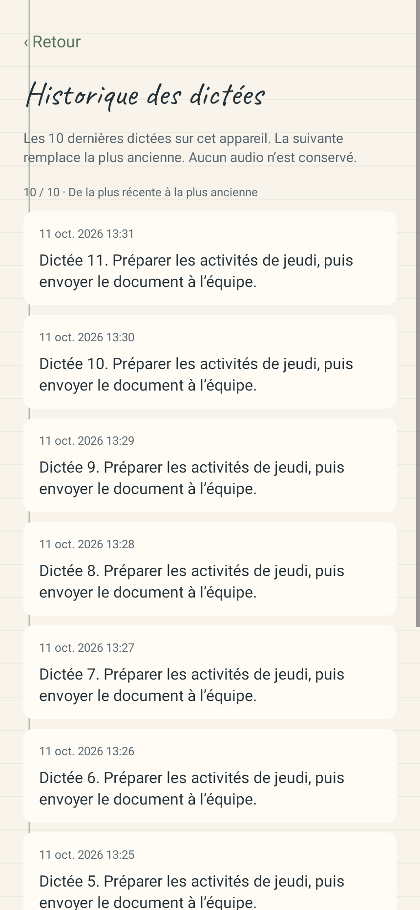
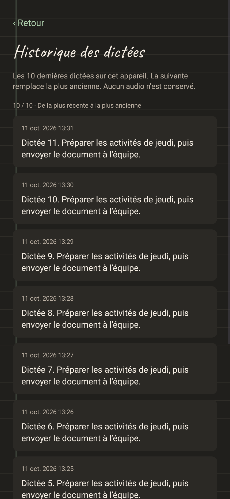

# DictAI Android 0.9.16 — installation sur le Poco

La version **0.9.16-dictai**, code 45, est installée sur le Poco F7 physique sous Android 16. Elle remplace la version 0.9.13, code 42, par une mise à jour avec conservation des données.

## Préservation vérifiée

Une sauvegarde privée complète de l’espace de données de DictAI et de l’ancien APK est conservée sur le Mac, hors du dépôt. L’archive a été relue et ses fichiers contrôlés. Le certificat de signature des deux APK est identique, et l’identifiant Android de l’application est conservé.

Après installation et avant la première ouverture, les **29 fichiers de données durables** sont strictement identiques à la sauvegarde par comparaison SHA-256. Cela comprend les préférences, les données du compte, les notes, les dossiers, les images et le modèle vocal.

| Contenu antérieur | Conservé |
| --- | ---: |
| Notes | 62 |
| Dossiers | 10 |
| Entrées de vocabulaire | 56 |
| Images originales | 7 |
| Modèle vocal local | 1 |

L’installation utilise l’APK issu de la [compilation GitHub Actions 38135603758](https://github.com/Uhama91/DictAI/actions/runs/38135603758). Son SHA-256 est `fc53f27201eee7902a9515d351c38fb8e7f2e360dba5a39e44027a5df77403a0`. La commande de mise à jour `adb install -r` a retourné `Success`, puis la version installée a été contrôlée sur le Poco.

La connexion USB s’interrompait à répétition. L’outil officiel Google ADB 37.0.1 a détecté la connexion Wi-Fi du même Poco ; cette liaison a permis la sauvegarde et l’installation. Le remplacement des données de l’application n’a pas été nécessaire.

## Historique et essai physique

Les 748 tests Android de la livraison couvrent le tampon limité à dix dictées, l’éviction de la plus ancienne, la persistance après réouverture et la copie intégrale. Les aperçus ci-dessous proviennent de ces tests natifs avec des données synthétiques.

Une vraie dictée de l’utilisateur est retrouvée dans le fichier local et dans l’écran d’historique du Poco mis à jour. Le bouton **Copier le texte** restitue exactement la transcription complète : les empreintes du texte enregistré et du presse-papiers sont identiques. Après retour à l’accueil puis réouverture de l’historique, la même entrée reste affichée, avec un identifiant, un texte et une date inchangés.

Après cet essai, les données antérieures restent présentes. Les notes, dossiers, images, éléments de vocabulaire et modèle vocal sont conservés. Dans les préférences générales, seuls le diagnostic de la dernière correction et la fin de l’assistant d’installation ont évolué ; aucune clé antérieure n’a disparu. L’accessibilité de DictAI est active. La limite de dix entrées et le redémarrage complet sont couverts par les tests automatisés ; l’essai physique utilise une dictée réelle sans remplir ni effacer le tampon de l’utilisateur.

La tablette n’est pas encore accessible pour cette installation. Sa mise à jour et son essai physique restent à effectuer.

## Aperçus des tests natifs

