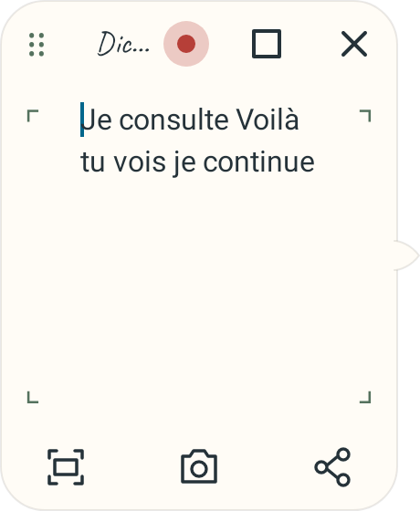
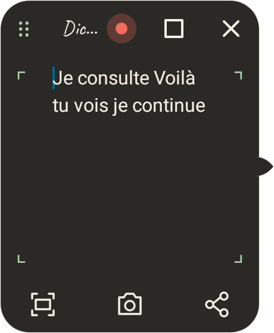
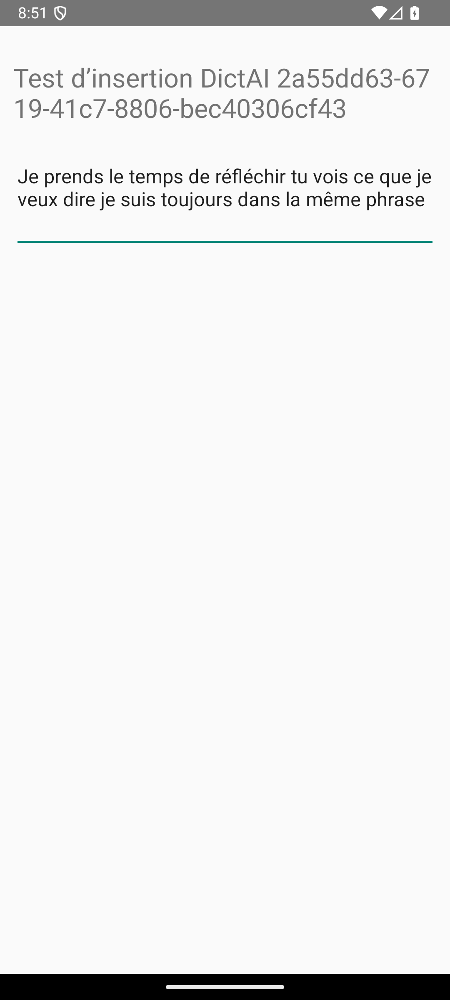
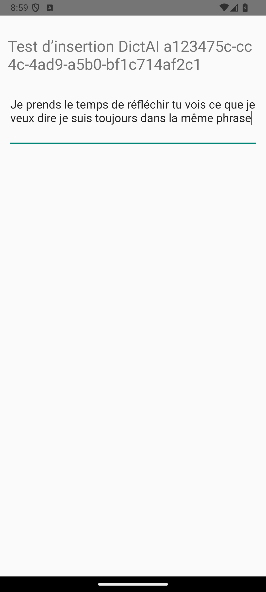
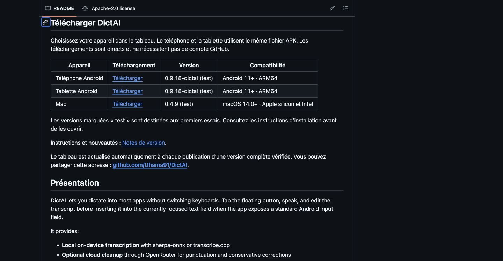
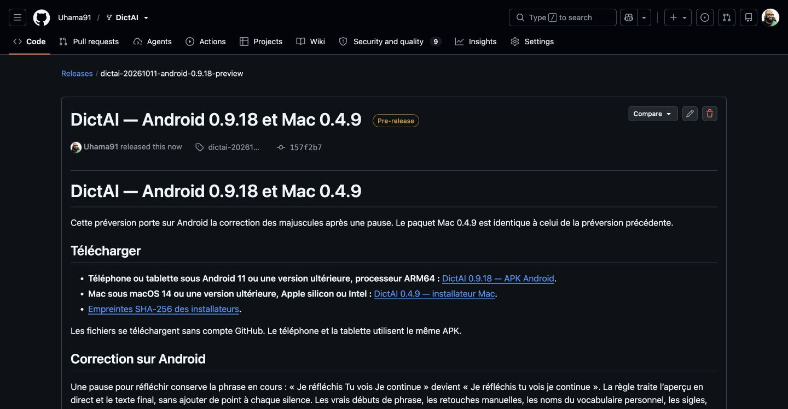

# DictAI Android 0.9.18 — majuscules après une pause

La correction des majuscules après une pause est portée sur Android. L’aperçu en direct et le texte final utilisent la même règle : « Je prends le temps de réfléchir Tu vois ce que je veux dire Je suis toujours dans la même phrase » devient « Je prends le temps de réfléchir tu vois ce que je veux dire je suis toujours dans la même phrase ».

Une durée de silence n’ajoute ni point ni frontière de phrase. La correction locale traite les continuations françaises courantes, les pronoms, les articles, les mots de liaison et les élisions. Les mots ambigus sont conservés par prudence. Les points, points d’interrogation, points d’exclamation et paragraphes produits par le moteur ou saisis par l’utilisateur conservent les vrais débuts de phrase.

Les noms du vocabulaire personnel, les sigles, les citations, les identifiants et les liens restent protégés. Le texte retouché au clavier reste intact ; seule la continuation reconnue peut être corrigée. La langue choisie au début de l’enregistrement est respectée : les règles françaises ne modifient pas la dictée anglaise. Aucun modèle de correction supplémentaire n’est nécessaire.

## Vérification

Quatre régressions ont été observées en échec avant la correction, avec des résultats vocaux contrôlés : pauses naturelles, reprise après retouche, adverbes/élisions et préfixe modifié au clavier. La suite complète passe ensuite avec 774 tests, sans échec ni test ignoré. Le service Android réel est couvert de l’aperçu jusqu’à la publication du texte et à son enregistrement dans l’historique. Les protections du vocabulaire et l’option de langue sont vérifiées à cette frontière.

L’APK 0.9.18-dictai, code 47, est construit avec l’identifiant et le certificat de test précédents. Ses neuf bibliothèques natives passent le contrôle ELF et ZIP à 16 Ko. Cinq essais instrumentés sur un émulateur Android ARM64 passent : insertion dans un champ externe vide ou déjà rempli, plusieurs pauses et reprise avec retouche. Le runner coupe le processus cible au démarrage ; le script `scripts/verify_pause_insertion_emulator.py` reconnecte donc le service après ce démarrage. Les premiers essais ont aussi nécessité de relancer System UI après une erreur ANR. Les parcours natifs ci-dessous utilisent des résultats ASR contrôlés ; ils ne constituent pas une validation acoustique d’une voix humaine sur Poco F7 ou Pad 7.

## Publication

La [préversion Android 0.9.18 et Mac 0.4.9](https://github.com/Uhama91/DictAI/releases/tag/dictai-20261011-android-0.9.18-preview) est publiée. Le correctif Android est commité et poussé sur `main` dans `157f2b7406cd877353a138ce2feef83bceaa7277`. La [construction GitHub Actions](https://github.com/Uhama91/DictAI/actions/runs/38165724741) passe avec les tests, le contrôle des bibliothèques natives, la signature et l’alignement ZIP à 16 Ko.

L’APK publié provient de cet artefact CI. Les cinq essais d’insertion sont également réussis avec ce fichier précis sur l’émulateur ARM64. Le paquet Mac 0.4.9 est repris de la publication précédente avec les mêmes octets. Les quatre fichiers de la préversion sont téléchargés publiquement sans authentification, avec un statut HTTP 200 et des empreintes identiques à celles des fichiers vérifiés.

- [Installer Android 0.9.18 sur téléphone ou tablette](https://github.com/Uhama91/DictAI/releases/download/dictai-20261011-android-0.9.18-preview/DictAI-android.apk).
- [Installer Mac 0.4.9](https://github.com/Uhama91/DictAI/releases/download/dictai-20261011-android-0.9.18-preview/DictAI-macOS.pkg).
- [Empreintes SHA-256](https://github.com/Uhama91/DictAI/releases/download/dictai-20261011-android-0.9.18-preview/SHA256SUMS).

Le [workflow du tableau de téléchargement](https://github.com/Uhama91/DictAI/actions/runs/38166144318) réussit et actualise le README dans `4f107ba53187a3a9d606922fa380370d78947e59`. Les lignes téléphone et tablette proposent Android 0.9.18 ; la ligne Mac propose 0.4.9. Le manifeste reste celui d’une préversion de test.

Les preuves de construction, d’insertion native et de téléchargement sont conservées dans `docs/research/android-pause-capitals/`. La validation acoustique avec une voix humaine et plusieurs silences sur les appareils physiques Poco F7 et Pad 7 reste à faire.
