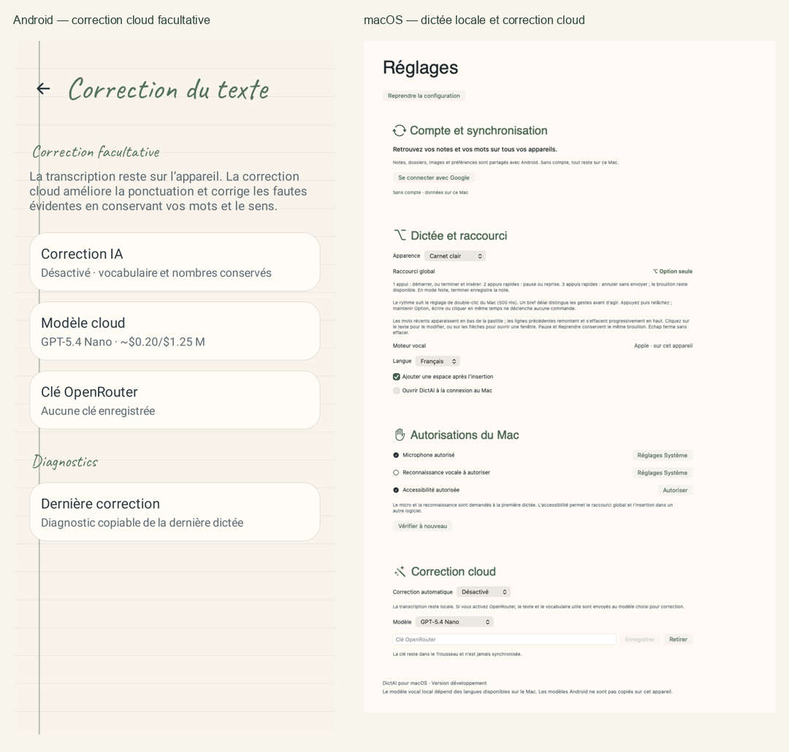
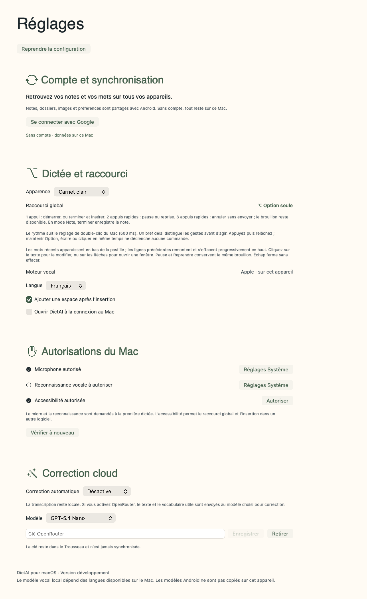
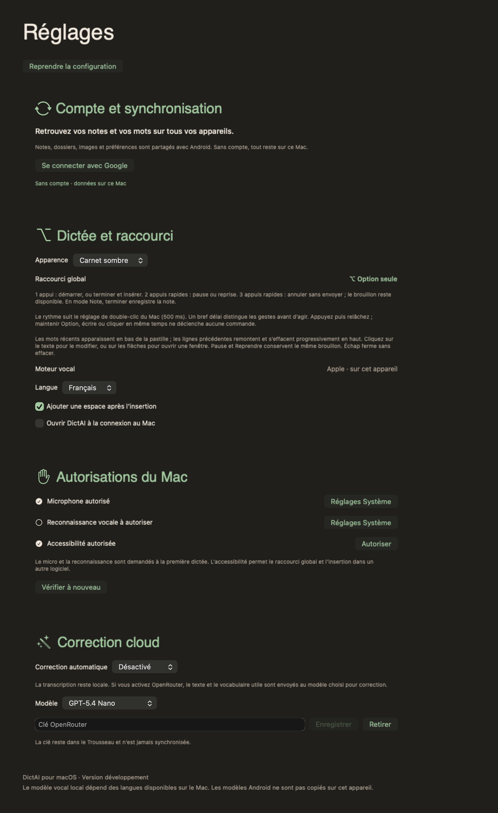
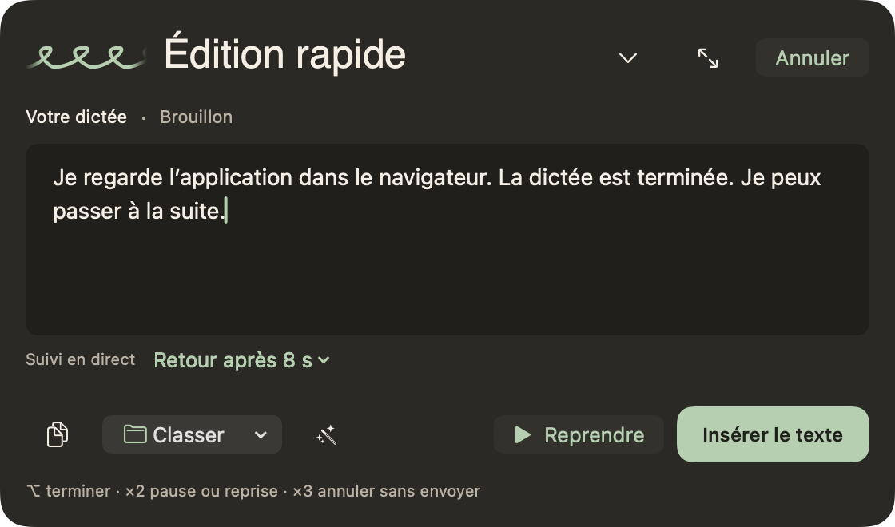
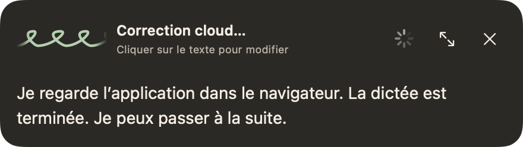
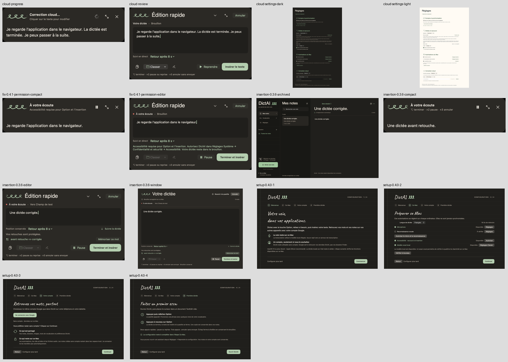

# DictAI : correction cloud seule — 11 octobre 2026

Android 0.9.15 (build 44) et macOS 0.4.3 (build 13) conservent la dictée actuelle. Nemotron reste disponible et recommandé sur Android ; le Mac conserve la reconnaissance vocale Apple locale. Le post-traitement par modèle devient exclusivement cloud et facultatif.

Les moteurs de correction locaux Gemma/LiteRT et Apple Intelligence, leurs téléchargements et leurs commandes sont retirés des applications. Les formats Liste, Mail, Texte corrigé et personnels ne sont plus proposés ni exécutés. OpenRouter reçoit une consigne fixe de correction fidèle, sans transformation en liste ou en courriel. Les règles de vocabulaire, de nombres et de typographie déjà réalisées dans le code restent appliquées sans modèle de correction local.

Le prototype de reconnaissance du mode Réunion est abandonné. Sa branche expérimentale n’a pas été intégrée à la version actuelle. Les autres moteurs vocaux du catalogue Android restent disponibles.

## Données conservées

Les notes, dossiers, images, règles de vocabulaire, comptes et protocoles de synchronisation sont conservés. Les anciennes définitions de formats restent dans les données partagées pour éviter de les effacer sur les autres appareils, mais ne sont jamais utilisées pour une requête cloud. Les anciens réglages de ponctuation du Mac restent sur disque, sans être lus ni exécutés.

Sur Android, une ancienne sélection de correction locale est migrée vers la correction cloud. Une clé OpenRouter est nécessaire pour la faire fonctionner ; en son absence ou en cas d’échec réseau, le texte reconnu reste disponible. Une correction déjà désactivée reste désactivée. Les clés ne sont jamais synchronisées.

## Rattrapage GitHub

Avant cette simplification, les sources et la CI du compagnon macOS ont été ajoutées au dépôt et la version actuelle Android 0.9.14/macOS 0.4.2 a été publiée sur `main`, au commit `9cd520353295d186bb6f1b2add90701aa36bda88`. La mise à jour a utilisé une avance normale de Git, sans réécrire l’historique. Les changements de simplification sont regroupés sur `codex/cloud-cleanup-only` puis publiés sur `main`.

Les builds Android sont disponibles dans le workflow [Build DictAI APK](https://github.com/Uhama91/DictAI/actions/workflows/build.yml), artefact `dictai-debug-apk`. Le workflow [DictAI macOS](https://github.com/Uhama91/DictAI/actions/workflows/macos.yml) fournit l’artefact `dictai-macos`. Choisir un run réussi de `main` correspondant à ces versions.

## Vérifications

- Android : 741 tests JVM réussis, APK et APK de tests compilés, y compris avec l’ancien paramètre `localFormatPrototype=true` pour vérifier qu’il ne réactive plus de moteur local.
- macOS : 139 tests ARM et 139 tests x86_64 sous Rosetta réussis. L’installateur universel est compilé et sa signature ad hoc est vérifiée.
- Les tests couvrent la migration des réglages, la conservation des données, la neutralisation des anciens formats dans les requêtes HTTP et les parcours de dictée/insertion existants.
- Android : les contrôles de packaging exigent les bibliothèques ASR et refusent les runtimes, poids et prompts des modèles de correction locaux.
- Interfaces : cinq rendus Android téléphone/tablette et quatorze rendus Mac sont produits avec les vues natives et audités visuellement.

Les requêtes cloud sont vérifiées avec des réponses HTTP de test ; aucun résultat de qualité ou de délai d’un modèle cloud réel n’est revendiqué. Les rendus utilisent des bibliothèques isolées. La 0.4.3 est désormais installée sur le Mac : les 13 fichiers étaient identiques avant ouverture et leur contenu intégral reste conservé après ouverture (55 notes, 56 entrées de vocabulaire, 10 dossiers et 7 images). Le microphone, la reconnaissance et le modèle vocal français sont disponibles ; l’accessibilité a été renouvelée après validation Touch ID et le raccourci Option a été relancé. Aucun téléphone n’était connecté par ADB. L’installation Android, l’essai vocal physique des nouvelles versions, la notarisation macOS et un essai sur Mac Intel physique restent à valider.

## Aperçus Android

Réglages clairs et sombres : uniquement correction cloud ou désactivation, modèle et clé OpenRouter.

Les lignes s’adaptent à un petit téléphone et à une tablette.

## Aperçus macOS

Réglages clairs et sombres, sans ponctuation Apple Intelligence ni formats.

Planche de contrôle des quatorze rendus Mac, incluant les parcours voisins d’insertion et de configuration :

