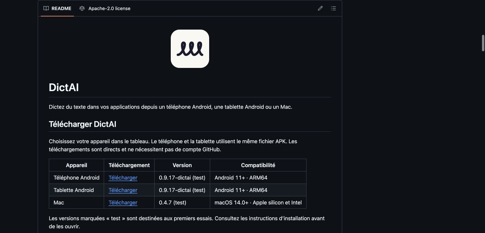
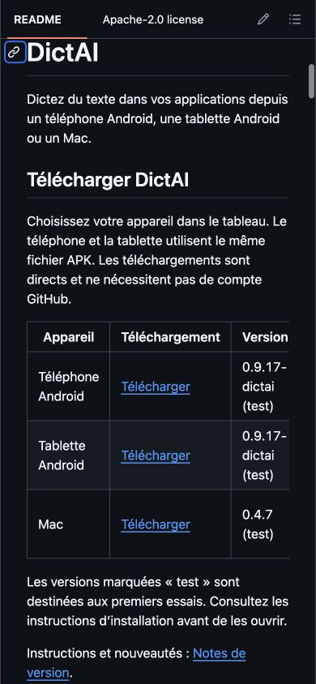
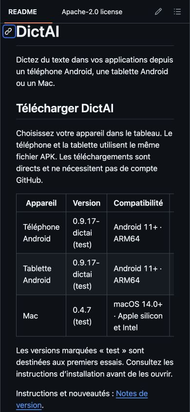
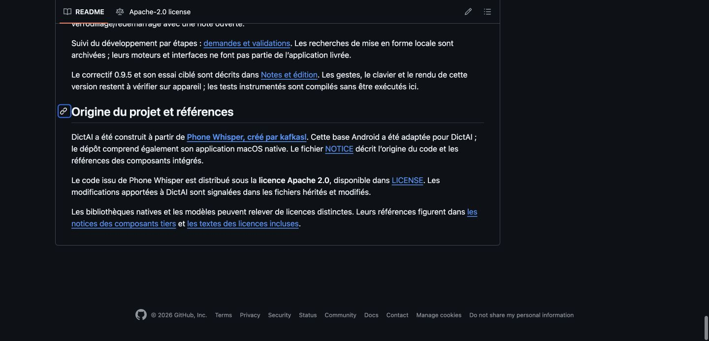

# DictAI : téléchargements depuis le dépôt public

L’adresse à partager aux testeurs est **[github.com/Uhama91/DictAI](https://github.com/Uhama91/DictAI)**. Le dépôt est public et les installateurs se téléchargent sans compte GitHub. Son introduction présente désormais un tableau avec les liens directs pour les téléphones Android, les tablettes Android et les Mac.

| Appareil | Version de test publiée | Compatibilité de l’installateur |
|---|---|---|
| Téléphone et tablette Android | 0.9.17-dictai / code 46 | Android 11 ou plus récent, ARM64 ; même APK pour les deux |
| Mac | 0.4.7 / build 17 | macOS 14 ou plus récent, Apple silicon et Intel |

Le bouton de téléchargement est placé juste après le nom de l’appareil pour rester visible dès l’ouverture du tableau sur un téléphone. Les notes de version expliquent l’installation, y compris les autorisations Android et le paquet Mac de test sans notarisation Apple.

Le logo de l’introduction reprend à l’identique l’icône actuelle de l’application : trois boucles sombres sur fond crème. Les origines et les références se trouvent désormais tout en bas du README. Elles nomment Phone Whisper, créé par kafkasl, comme point de départ de DictAI et conservent les liens vers Apache 2.0, NOTICE et les licences des composants tiers.

## Maintenance automatique vérifiée

Le workflow renouvelle le tableau lorsqu’une version complète est publiée depuis `main`, avec son manifeste et ses installateurs vérifiés. Les noms de version et les architectures proviennent des fichiers préparés. Les anciennes versions et les expériences de modèles ne remplacent pas une distribution plus récente. Le [guide de publication](research/app-updates/publication.md#maintenir-le-tableau-de-téléchargement-du-dépôt) précise la préparation des assets et le déclenchement manuel pour les anciennes releases ou les publications faites par un autre workflow.

Les cinq tests du manifeste et les sept tests du tableau réussissent localement et sur GitHub. La [première exécution](https://github.com/Uhama91/DictAI/actions/runs/38151738186) a effectivement publié un changement du README avec le commit `a5a58bc`. La [seconde exécution](https://github.com/Uhama91/DictAI/actions/runs/38151977361), après la correction du petit écran, confirme que le tableau est à jour. Les téléchargements anonymes de l’APK et du PKG retournent HTTP 200 ; leurs empreintes correspondent au manifeste publié. [Preuve technique](research/github-downloads/verification.json).

Ces fichiers restent des versions de test. Le tableau du dépôt est actif ; les notifications dans l’application attendent encore la première distribution stable signée. Le site et l’achat du domaine restent prévus ultérieurement dans le [plan](superpowers/plans/2026-10-11-github-download-table.md).

## Rendu publié sur ordinateur

Capture de la vraie page GitHub sur `main` (`6554072`), après inspection visuelle.

## Rendu publié sur téléphone

Audit en portrait 390 × 844. Les trois liens sont visibles et accessibles au clavier sans défilement horizontal préalable. La colonne Compatibilité reste accessible en faisant défiler le tableau. Il s’agit d’un contrôle du navigateur, pas d’un nouvel essai d’installation sur un téléphone physique.

Le premier rendu masquait les téléchargements à droite. L’audit a conduit à déplacer cette colonne avant Version et Compatibilité.

## Origines et références en bas de page

