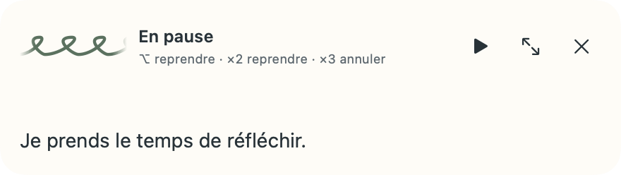
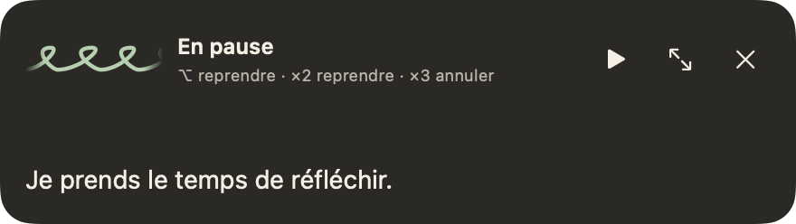
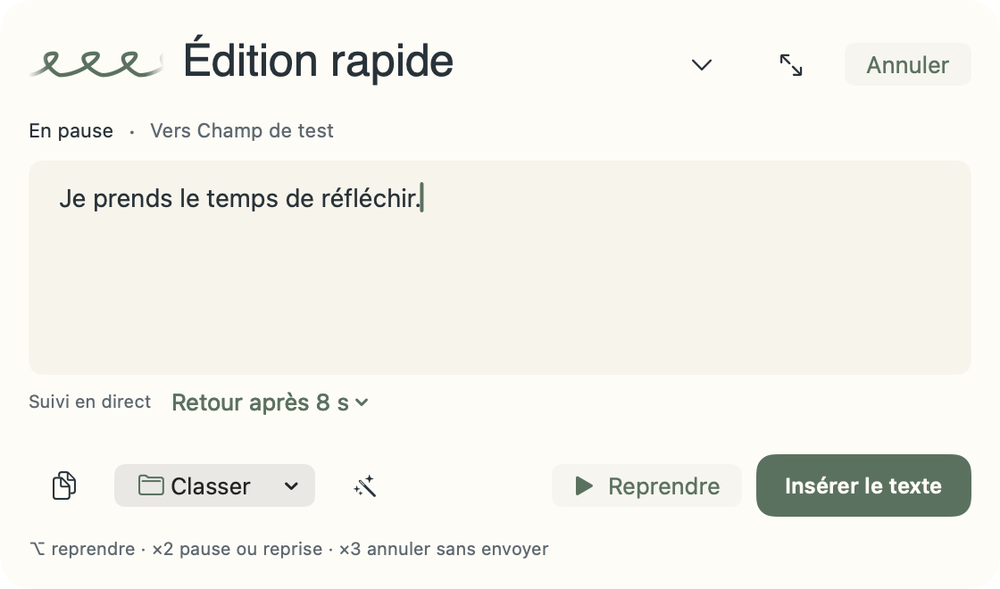
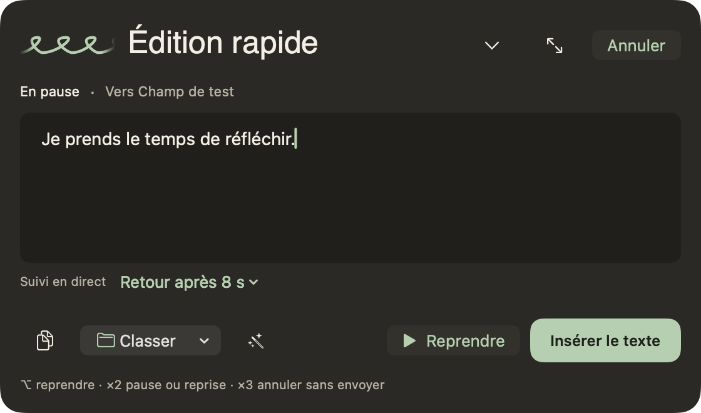
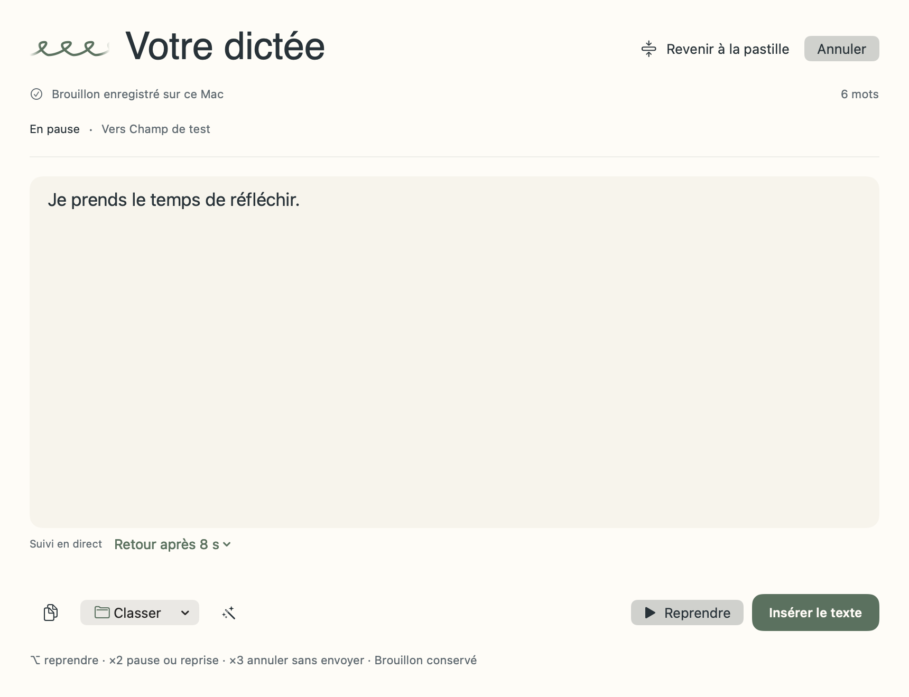
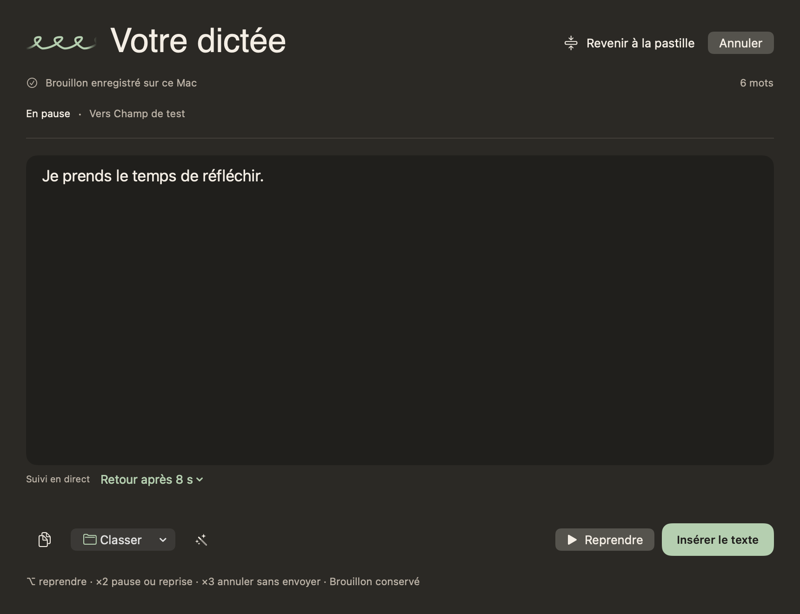
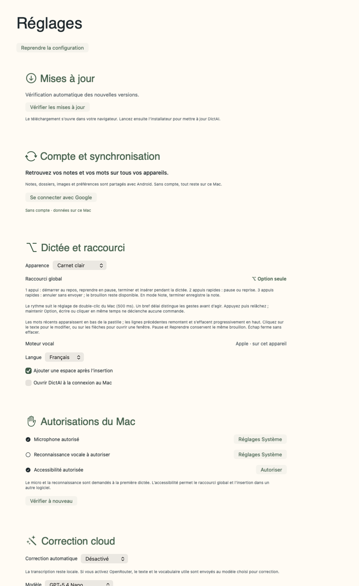
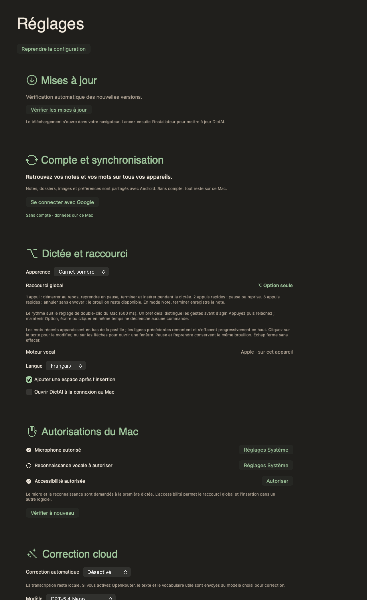
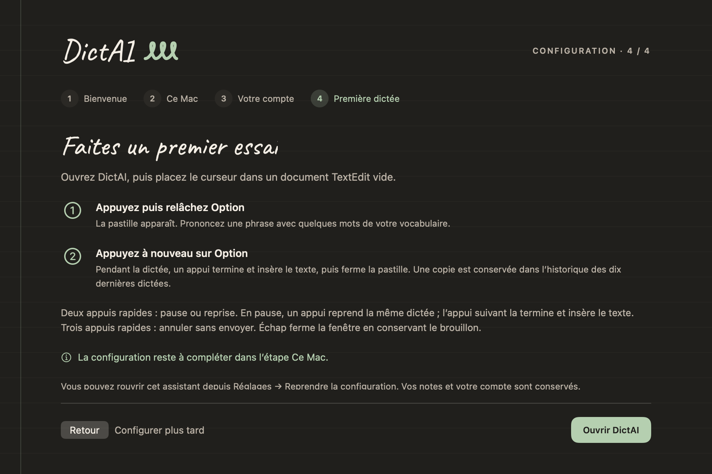

# DictAI macOS 0.4.8 — reprise avec Option

Un appui sur Option pendant une pause reprend désormais l’enregistrement dans le même brouillon. L’appui suivant, pendant la dictée, termine la reconnaissance et insère tout le texte dans le champ actuellement sélectionné. Deux appuis rapides mettent en pause ou reprennent la dictée. Trois appuis rapides annulent sans insertion et conservent le brouillon récupérable.

La reprise reste possible pendant la finalisation du segment vocal précédent. Elle attend son dernier résultat avant de relancer l’écoute. Une demande de reprise n’active ni l’insertion ni la correction cloud. La correction configurée intervient à la fin de la dictée reprise.

Les indications de la pastille, des deux éditeurs, de la bibliothèque, des réglages et de l’assistant sont mises à jour. Les boutons d’insertion explicite restent disponibles pendant une pause.

## Vérification

- Les tests de régression ont d’abord reproduit l’insertion prématurée avec l’ancien comportement.
- 162 tests macOS dans 26 suites réussis sur ARM et 162 sur Intel via Rosetta après la correction.
- Même brouillon dans les trois présentations ; reprise d’une dictée vide ; résultat vocal tardif conservé ; reprise en attente annulable.
- Insertion unique de la dictée complète dans le champ actuel après la reprise, avec récupération dans l’historique.
- Vraies fenêtres AppKit vérifiées en clair et en sombre : la reprise les conserve ouvertes et l’insertion terminée les ferme.
- Rendus natifs à deux pixels par point inspectés visuellement : indications lisibles, commandes et texte sans débordement.

Les essais automatisés utilisent une capture et une livraison contrôlées. Ils ne remplacent pas l’essai physique de la touche Option et du microphone dans l’application installée.

## Aperçus natifs

## Livraison

Version 0.4.8, build 18, installée et ouverte dans `/Applications/DictAI.app`. Installateur universel ARM/Intel vérifié et signature locale valide. Le binaire installé est identique au binaire construit ; SHA-256 du paquet : `4c7b81c79e336d460597ff094021f0e6affbed393e9818fcc6db6dddf92cb279`.

Sauvegarde privée de l’application précédente et des données vérifiée. Les 14 fichiers de données sont strictement identiques avant la première ouverture. Après ouverture, les entrées originales des bibliothèques sont conservées intégralement, ainsi que le texte du brouillon, l’historique et les images. L’interface retrouve 62 notes, 57 entrées de vocabulaire et le compte connecté.

Microphone et reconnaissance vocale renouvelés après validation de l’utilisateur. L’entrée d’accessibilité est réinscrite en sélectionnant `/Applications/DictAI.app` et l’application confirme les trois autorisations. Le modèle vocal français est disponible. L’essai vocal physique du nouveau geste reste à réaliser.

La correction est livrée localement ; la préversion GitHub reste en 0.4.7.
