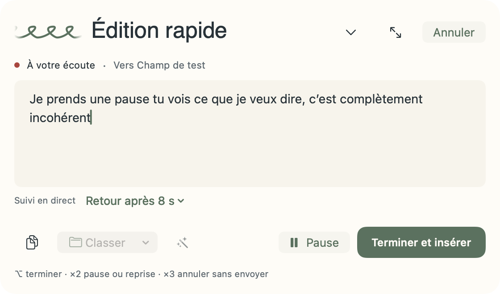
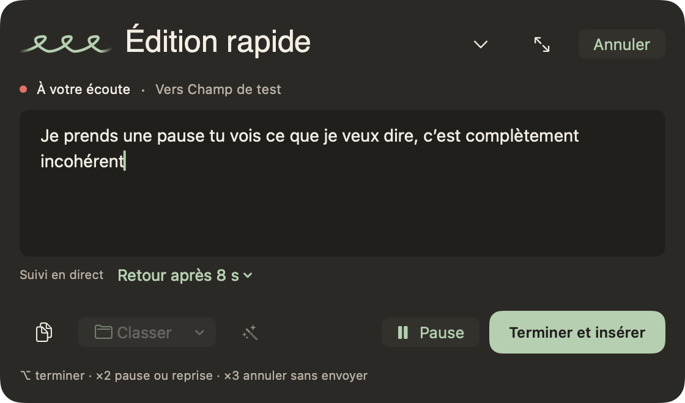

# DictAI macOS 0.4.9 — majuscules après une pause

Une pause pour réfléchir conserve la phrase en cours. Par exemple, « Je prends une pause » suivi de « Tu vois ce que je veux dire » donne désormais « Je prends une pause tu vois ce que je veux dire », sans ajouter de point pendant l’enregistrement.

Le raccord précédent ne corrigeait qu’une courte liste de mots français. Des pronoms comme « Tu » et « Je », ainsi que certaines majuscules dans les résultats provisoires du moteur Apple, restaient donc au milieu de la phrase. La même règle de casse traite désormais les résultats provisoires, les changements de segment et les reprises après une pause.

Les débuts de phrase après une ponctuation explicite, les paragraphes, les citations, les sigles, les identifiants techniques, les retouches manuelles et les noms du vocabulaire personnel sont protégés. L’analyse grammaticale est locale ; les noms et les mots ambigus sont conservés par prudence. La protection du vocabulaire réutilise ses expressions compilées pour éviter de ralentir chaque résultat.

La [ponctuation automatique du moteur Apple](https://developer.apple.com/documentation/speech/sfspeechrecognitionrequest/addspunctuation) reste activée. Ce correctif ne transforme pas une durée de silence en frontière de phrase et ne réactive aucun post-traitement IA obligatoire. La ponctuation produite par le moteur reste dépendante de la reconnaissance réelle.

## Vérification

- Tests de régression observés en échec avant la correction : « Tu », « Je », « Voilà », « Incohérent », virgule, point-virgule, contractions et nom propre après un mot de liaison.
- Résultats provisoires, fin naturelle du segment, pause et reprise explicites, insertion unique et historique du texte complet vérifiés par des tests du parcours de dictée.
- Noms appris protégés jusqu’à l’insertion ; ajout et retrait d’une protection vérifiés sans décision périmée. La langue anglaise conserve son comportement.
- 173 tests réussis sur ARM et 173 sur Intel via Rosetta, dans 26 suites ; sorties consignées dans `docs/research/macos-pause-capitals/`.
- Deux rendus natifs inspectés visuellement : texte lisible, commandes intactes et phrase conservée sans majuscule parasite ni point final pendant l’écoute.

Les tests automatisés utilisent des résultats vocaux contrôlés. Après l’installation et le renouvellement des autorisations, l’utilisateur a aussi effectué une vraie dictée avec plusieurs silences dans la même phrase. Le texte inséré conserve notamment « tu vois ce que je veux dire je suis toujours dans la même phrase » en minuscules ; l’utilisateur confirme que ce cas fonctionne. Les autres cas du moteur vocal restent couverts par les régressions automatisées.

## Aperçus natifs

## Livraison

Version 0.4.9, build 19, installée et ouverte depuis `/Applications/DictAI.app` après l’authentification de l’utilisateur. Le binaire installé correspond au binaire universel ARM/Intel vérifié. Une sauvegarde privée de l’application précédente et des 14 fichiers de données est contrôlée ; les 14 fichiers étaient identiques avant la première ouverture. Après l’ouverture, toutes les valeurs originales de la bibliothèque, l’historique, le texte du brouillon et les sept images sont conservés. L’interface retrouve 62 notes, 10 dossiers et 57 entrées de vocabulaire.

Les trois autorisations sont confirmées dans l’application installée : microphone, reconnaissance vocale et accessibilité. Le modèle français local est disponible et la correction cloud reste désactivée. La dictée physique avec plusieurs silences et son insertion sont confirmées par l’utilisateur.

La vérification de fermeture de l’installateur vise désormais le chemin de l’application remplacée. Une copie de démonstration distincte ne bloque plus la mise à jour ; le refus erroné a été observé avant la correction et sa disparition vérifiée après. Le refus reste actif lorsque l’application installée fonctionne.

## Publication GitHub

La publication de la 0.4.9 est en préparation. La première CI a mis en évidence une différence de classification grammaticale entre le Mac local et l’environnement GitHub : « Complètement », « Ensuite » et les élisions telles que « J’ai » ou « L’application » restaient capitalisées. Un repli déterministe traite désormais ces continuations même sans étiquette grammaticale. Un test reproduit explicitement cette absence et protège les noms, le vocabulaire et les vrais débuts de phrase.

Le paquet destiné à GitHub sera reconstruit avec ce repli supplémentaire. L’essai vocal réel ci-dessus concerne le premier paquet installé ; la validation du repli ajoute une régression automatisée. L’APK Android reste celui de la version 0.9.17, sans changement de code ni d’octets.
