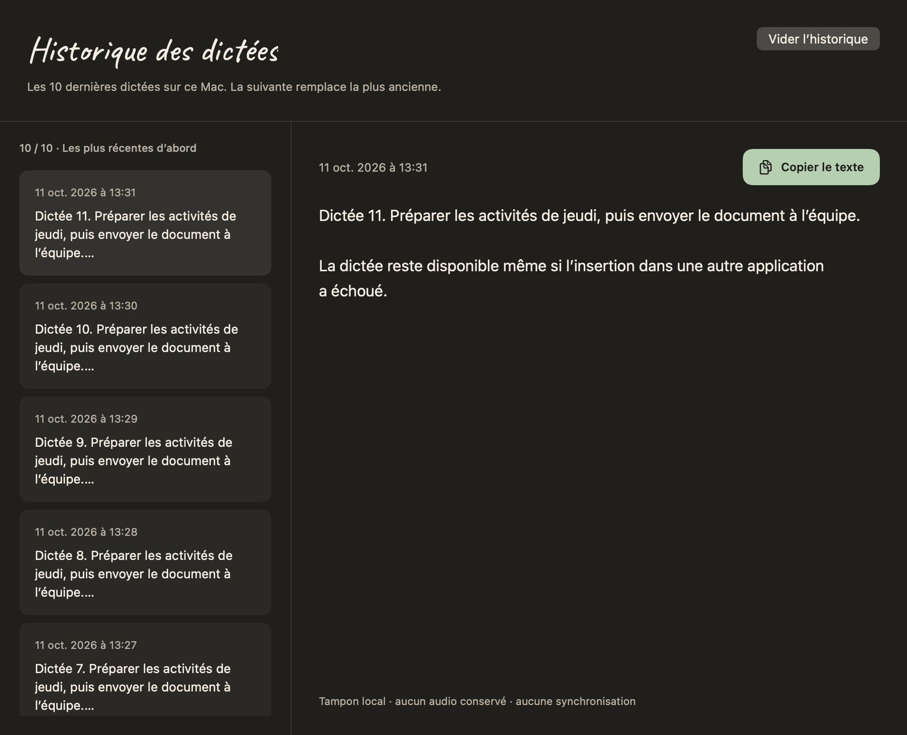

# DictAI macOS 0.4.6 — accès rapide et installation

L’icône DictAI de la barre des menus donne accès à la dernière transcription complète, à l’historique des dix dernières dictées, à la bibliothèque, aux réglages et à la fermeture complète de l’application. Pendant une dictée, le menu propose aussi la pause ou la reprise. La copie rapide est désactivée lorsque l’historique est vide et ne modifie ni les notes ni le brouillon.

L’icône utilise désormais une vraie `Image` issue du logo, et non un `Shape` SwiftUI ignoré dans ce libellé. Son rendu natif comporte des pixels visibles et adopte l’apparence du système. L’utilisation d’une image correspond à l’API de [MenuBarExtra documentée par Apple](https://developer.apple.com/documentation/swiftui/menubarextra).

Le tampon d’historique est local et borné à dix entrées. Il survit à une fermeture de l’application ; la onzième dictée remplace la plus ancienne. Il ne synchronise ni texte ni audio. Les notes enregistrées volontairement restent indépendantes.

## Vérifications

- 152 tests dans 23 suites réussis sur ARM ; 152 tests réussis sur Intel via Rosetta. Rendu final de l’icône également vérifié sur les deux architectures.
- Copie du texte intégral dans un vrai presse-papiers isolé : plusieurs paragraphes et Unicode, dernière dictée prioritaire sur le brouillon, bibliothèque intacte.
- Historique vide : contenu du presse-papiers préservé.
- Installateur universel ARM/Intel vérifié, signature locale valide, version 0.4.6 / build 16.
- Installation réelle dans `/Applications` après validation de l’authentification macOS par l’utilisateur.
- Treize fichiers de données identiques avant la première ouverture ; contenu intégral antérieur conservé après ouverture : 62 notes, 56 entrées de vocabulaire, 10 dossiers et 7 images. Identité de l’appareil et empreintes des images conservées. Sauvegarde privée des données et de l’ancienne application hors du dépôt.
- Microphone, reconnaissance vocale et accessibilité confirmés dans l’application installée après renouvellement des autorisations de la nouvelle signature locale.
- Dictées physiques de l’utilisateur insérées dans Codex : textes complets retrouvés dans le fichier local et dans la page d’historique de l’application installée, sans nouvelle note permanente.
- Copie réelle depuis la page d’historique : presse-papiers strictement égal au texte intégral de la dernière dictée.
- Fermeture complète constatée par l’absence de processus, puis mise à jour 0.4.6 : les quatorze fichiers de données sont strictement identiques avant la nouvelle ouverture, dont les sept dictées de l’historique.
- L’utilisateur confirme que l’icône est visible après installation de la 0.4.6.
- Copie depuis le menu installé confirmée par l’utilisateur et par comparaison exacte avec le texte de la dernière entrée et le presse-papiers système.
- Trois autorisations confirmées dans la 0.4.6 après validation des demandes macOS ; bibliothèque complète et sept dictées identiques après ouverture.

Le paquet local installé est `DictAI-0.4.6-macOS-test.pkg`, SHA-256 `eb94cbf136558b9833bfd763a394ce73ab53c6f6c02cde79d626107c91fa0b67`. Les captures de tests ci-dessous utilisent des données synthétiques ; aucune donnée personnelle de la bibliothèque n’est publiée.

## Aperçu natif de l’historique

## Validation physique

Les dictées physiques dans Codex, leur récupération dans l’historique, la copie intégrale depuis la bibliothèque et le menu, et la conservation après fermeture et mise à jour sont confirmées. L’éviction de la onzième dictée est couverte par les tests natifs. Le [Poco et la tablette sont ensuite mis à jour en 0.9.16](2026-10-11-android-installation.md), avec conservation des données et accessibilité active. Sur les deux appareils, une vraie dictée est retrouvée dans l’historique, copiée intégralement et conservée après réouverture de cet écran.

## Publication GitHub

Sources publiées sur `main`, commit `fbbd51f905e7ec3f8ede90d18eeae739f6a12f4a`. La [compilation GitHub Actions 38138576586](https://github.com/Uhama91/DictAI/actions/runs/38138576586) a réussi : 152 tests, installateur universel contrôlé et artefact `dictai-macos` (`11701158666`). Après téléchargement, le paquet est à nouveau vérifié ; SHA-256 `ddb10cc0c0102dc583e59102893815e17de782a1c45881acdd3f4812792e03ac`. Ce paquet CI n’est pas réinstallé sur le Mac pour éviter un nouveau renouvellement des autorisations : le paquet local installé contient la même version de source vérifiée.
