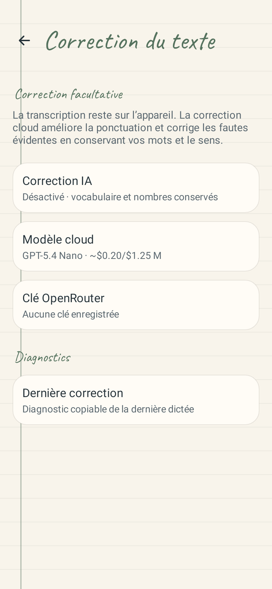
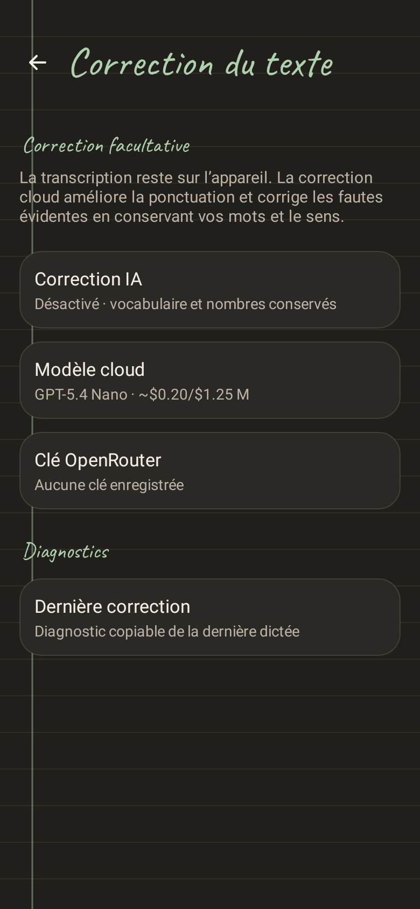
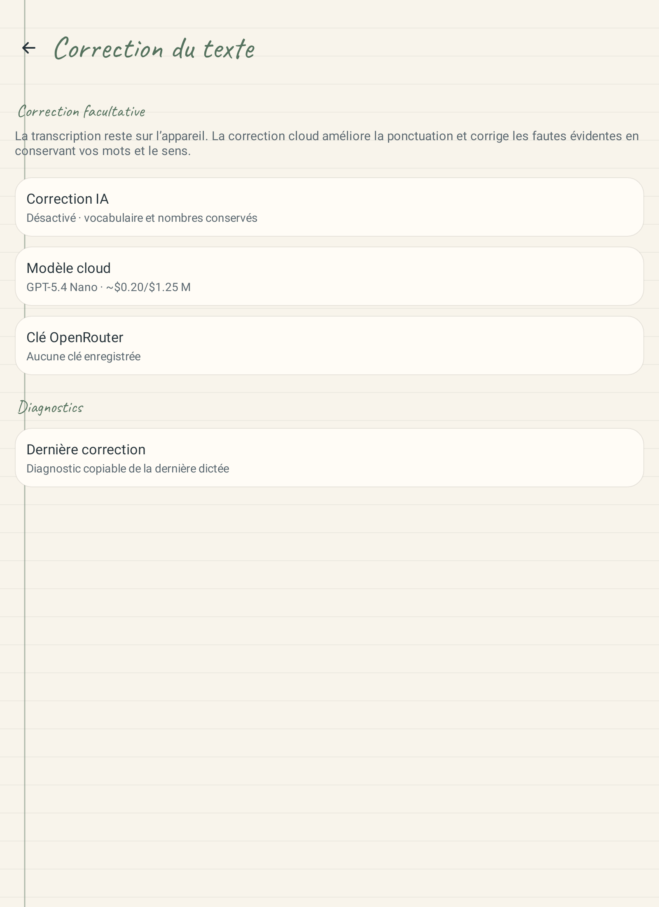
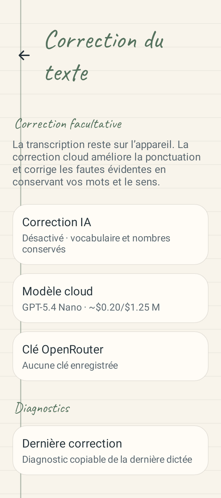
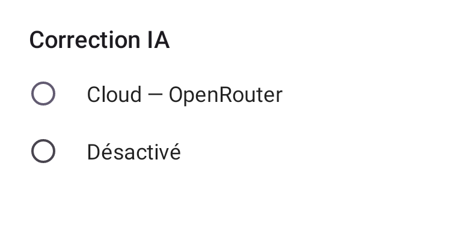

# DictAI Android 0.9.15 — correction cloud facultative

La transcription Nemotron et les autres moteurs vocaux existants restent locaux.
La seule correction IA disponible est une correction cloud facultative par
OpenRouter. Les modes Texte corrigé, Liste, Mail et les formats personnalisés
ne sont plus proposés ni exécutés. Les données historiques de formats restent
stockées et synchronisées pour préserver la compatibilité.

Les réglages locaux hérités passent durablement à Cloud. Les choix Désactivé,
Cloud et le modèle cloud explicitement choisi sont conservés. Sans choix de
modèle, GPT-5.4 Nano est proposé. Les retouches manuelles restent prioritaires ;
la correction IA est ignorée après une retouche. Le vocabulaire, les nombres,
le nettoyage léger, les notes, les captures et l’insertion restent disponibles.

Les sources de recherche Gemma, les interfaces de téléchargement et de banc
d’essai, et les prompts locaux sont conservés sous `app/src/test/`. Le runtime
LiteRT est limité aux dépendances de test. Les bibliothèques LLM et leurs prompts
sont absents de l’APK ; les neuf bibliothèques vocales natives sont conservées.
L’ancien drapeau `-PlocalFormatPrototype=true` ne peut plus activer le prototype.

## Vérification

- Tests ciblés : 24 tests, huit échecs attendus avant implémentation, puis tous verts.
- Suite complète finale : 741 tests dans 109 suites, aucun échec ni erreur.
- Contrôleur natif : 19 tests verts, dont le refus des trois runtimes LLM retirés.
- APK principal et APK de tests Android compilés avec JDK 21 et l’ancien drapeau du prototype.
- APK versionCode 44, versionName 0.9.15-dictai ; signature et alignement ZIP/ELF de 16 Ko vérifiés.
- API OpenRouter vérifiée avec MockWebServer : prompt fixe, absence de consignes de format, annulation réseau, erreurs et repli sur le texte d’origine.
- Cinq rendus Android natifs à double résolution inspectés : téléphone clair/sombre, tablette, petit écran et choix du moteur.

L’APK local préparé est `dist/dictai-debug.apk`, 58 219 396 octets.
SHA-256 : `38e14afecb5c966f937b47754dc24c58f6f3a4a3ae728e44a0338065a624b262`.

Aucune installation sur téléphone ou tablette n’a été effectuée. Les rendus
Robolectric et la compilation des tests instrumentés ne remplacent pas un essai
vocal et tactile sur les appareils physiques. Aucun appel cloud payant n’a été
réalisé pendant ces tests.

## Rendus audités

Téléphone, thème clair :

Téléphone, thème sombre :

Tablette :

Petit écran :

Choix du moteur :

